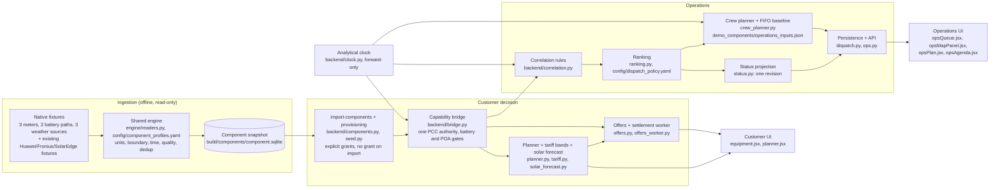

# Equipment replay architecture

All equipment values and operational inputs are synthetic. The component scenario uses the nine existing provider identities; the compact 60-site demo and the browser-only `/demo/` are separate populations.

## Notes

- **Configuration, not vendor code.** `config/component_profiles.yaml` selects readers and transforms; `config/component_evidence.yaml` is the native-field allowlist; `demo_components/assets.json` declares physical identity, authority and mounting. Mirrors remain evidence of the same physical meter, never another energy source. Counter resets withhold the crossing delta; incomplete measured coverage can waive an offer penalty (`meter_data_incomplete`).
- **One clock.** Planning, forecast issue time, telemetry freshness, offers, correlation and plan application use the forward-only analytical clock (`backend/clock.py`). Sessions, login and `audit.received_at` keep real wall time. Component data after the clock are never read.
- **Customer path.** `backend/bridge.py` gates usable evidence at the analytical clock and exposes `GET /api/v1/sites/{id}/equipment/summary`. `backend/planner.py` compares incremental site cost under versioned contract bands (`backend/tariff.py`), including displaced exports and a fair battery terminal value; a commitment is an immutable snapshot, and new evidence only suggests a review.
- **Operations path.** `backend/correlation.py` turns evidence into episodes (a rule without its evidence reports `not_evaluated`); `backend/ranking.py` bands them safety-first with written reasons; `backend/status.py` projects condition, telemetry, workflow, priority and crew separately; `backend/dispatch.py` persists episodes and plans and serves one operations revision to the queue, drawer, existing map and planner. The UI refetches rather than showing mixed revisions.
- **Synthetic operations inputs.** `demo_components/operations_inputs.json` is separate from vendor payloads and supplies fictional crews, qualifications, shifts, access windows, reported bases and an approximate travel matrix. `backend/crew_planner.py` produces a bounded **feasible heuristic proposal** and a feasible FIFO baseline under identical constraints. Applying a reviewed plan requires the dispatcher role, a matching input digest and an idempotency key; technicians update only their own crews' assignments, with revision checks.
- **Limits.** No native connector is live, no device controls are sent, and no electrical topology is inferred from geography. Enphase is excluded. Map routes are schematic estimates and crew markers are reported bases, not GPS.

See the [feasibility limits](./COMPONENT_SOURCE_NOTES.md#12-excluded-or-narrowed-summary), [dispatch policy](./DISPATCH_POLICY.md), [data dictionary](./COMPONENT_DATA_DICTIONARY.md) and [replay commands](../README.md#run-the-component-demo).
