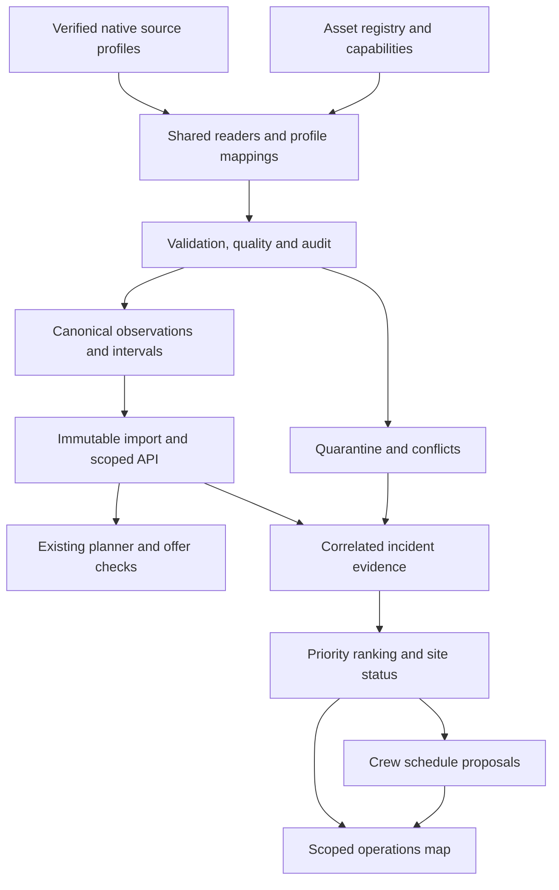

# Master coding prompt — feasible equipment data, incident intelligence and technician optimization

(Verbatim copy of the product owner's specification, supplied 15 Nov 2026. The equipment reference PDF it mentions is transcribed in EQUIPMENT_REFERENCE_SHEET.md next to this file.)

Complete revised specification. This document replaces the previous master prompt in full.

Paste this entire document into the coding assistant working inside the **existing One View Solar repository**. Supply the latest repository, README and equipment reference PDF. Implement the extension; do not stop at a plan.

## 1. Objective and constraints

We have approximately **12 hours total**, including visual polish, presentation and rehearsal. Four teammates will work on the project. Deliver a working, laptop-hosted prototype with a mobile customer workspace and an operations workspace.

The application already has a personal task planner, some offer suitability checks, business loads, contract-defined tariff time bands, Power Block Offers, user accounts, site access, telemetry views, incidents and operations workflows. Inspect the current code and **extend these features**. The supplied README contains older implementation-status statements; the actual current code and these requirements take precedence.

The extension must demonstrate:

1. Three different source datasets for each selected equipment family, realistically shaped like the documented sources.
2. One shared ingestion engine, with a component entry point and three declarative profiles per family; no separately coded scraper for every vendor.
3. Centralized, traceable measurements that preserve physical meaning.
4. A visible improvement to an existing customer decision: **when should a flexible business load run to minimize its estimated cost?**
5. Operations evidence that distinguishes a data/access problem, normal solar variability and an issue requiring review, without inventing a physical diagnosis.
6. Updated incident correlation/ranking across supported inverter, meter, battery and weather evidence, with no duplicated operational impact.
7. Technician assignment and visit-order optimization, reviewed by accounts explicitly authorized to manage crews, and synchronized with the existing operations map.

All device data are **synthetic**. No real vendor credentials, live hardware access, remote switching or claims of production certification are required. Keep a conspicuous synthetic/replay indicator in both workspaces.

Implement the complete vertical path for the scope below. Do not rebuild the product, change frameworks, add microservices, replace SQLite, train a large model or implement every item in the equipment sheet.

## 2. Scope: three candidate families, up to nine verified source datasets

Target **nine source datasets: three profiles × three equipment families**, in addition to the existing inverter fixtures, only where section 4.3's feasibility gate passes. Data realism takes precedence over reaching nine: omit an unsupported field, profile or component rather than fabricating its availability. Prefer three verified profiles; if only two are feasible, deliver two and explain the exclusion. A dataset may contain multiple endpoint files and devices; it is not just one example JSON object.

| Family | Three source profiles | Customer value | Operations value |
|---|---|---|---|
| Operational electricity meters | Schneider iEM3255 Modbus; Fronius Smart Meter via Solar API; Shelly Pro 3EM RPC | Know actual grid import/export; verify the energy basis of plans and offers | Show source freshness, boundary, counter continuity and discrepancies |
| Battery telemetry available through a gateway/cloud | Victron GX battery service; SolarEdge storageData; Enphase battery telemetry | Determine whether battery support is credible, preserve reserve and expose limits | Show available battery state, reported faults and missing capabilities |
| Local irradiance/weather observations | IMT Si-RS485TC-T-Tm-MB; Kipp & Zonen SMP10x; Campbell Scientific configured TOA5 station | Explain solar forecast changes and improve near-term planning when enough evidence exists | Distinguish weather-related production changes from unexplained underperformance |

The meters above are **internal/PCC operational meters**. They are not automatically the distribution operator's certified billing meter. A physical meter can be installed at different measurement boundaries; configure the boundary explicitly.

The battery family means **telemetry actually exposed through the selected interface**, not unrestricted access to all battery cells. The Enphase profile may expose only interval charge/discharge energy in its minimum version; absence of SoC is a useful capability difference.

The Campbell profile represents a configured logger with specified attached sensors. It is not a claim that all Campbell stations contain the same instruments or export identical columns.

Defer optimizer/microinverter detail, additional MPPT/string/AFCI devices, protection relay control, DLMS/COSEM decoding, binary CAN protocol implementation and a full power-quality analyzer. Retain extension hooks in the profile schema; do not generate unused mountains of data.

Do not introduce new hardware brands as compulsory dependencies of the app. These profiles demonstrate interoperability. Local irradiance sensors and standalone BMS gateways are optional installed assets, not equipment every existing site is assumed to own. If the only useful battery data already come from the inverter, reuse that acquisition path and physical asset identity instead of inventing another device.

## 3. First inspect and preserve the existing repository

Before editing, read the current README, STEP1_README.md, DATA_DICTIONARY.md, SOURCE_NOTES.md, provider profile YAML, generator, scraper, importer, migrations, generated contracts, frontend API client, planner, tariff evaluator, offer suitability/settlement code, incident ranking, crews/assignments and map/status aggregation. Inspect package scripts and existing tests.

Write a short implementation inventory identifying reusable modules and actual file paths. Then implement without waiting for approval. Reuse the existing naming and structure; paths proposed later in this prompt are examples.

Known baseline:

- Python 3.11+, FastAPI; SQLite with WAL and versioned migrations.
- React/Vite/TypeScript frontend; generated API types and a shared client.
- Existing inverter profiles: Huawei, Fronius, SolarEdge; nine fictional provider sites.
- Original generation window: 2026-07-15 through 2026-07-21, Europe/Bucharest.
- Provider observations preserve endpoint, device, channel, AC/DC boundary, aggregation, coverage, requirement classes and provenance.
- Provider import uses immutable snapshots and an atomic active-snapshot switch.
- A separate older compact 24-site demo also exists. **Do not mix identities between these two populations.**
- Existing roles include customer, technician, dispatcher and supervisor. Server-side site/area/assignment grants determine access.
- Existing cookie sessions, CSRF protection, hashed credentials, local account provisioning and bounded queries must remain.
- Existing Power Block Offers have capacity controls, atomic acceptance, metered fulfilment, financial snapshots, a settlement ledger, missing-data protections and notifications.

Preserve original fixture bytes, identities, checksums and existing tests. Do not silently regenerate the old datasets or wipe a database to make integration work. Add forward migrations only where needed.

Reuse the same nine provider site identities. Assign new equipment through an explicit asset registry. Not every site has a battery or a local irradiance sensor. At least one business site must support the full end-to-end demonstration.

If existing fixtures cannot be extended into a physically consistent scenario, create a **separately versioned scenario overlay for the same site identities**, with explicit provenance and import selection. Never concatenate contradictory old and new truths into an apparently coherent measurement stream.

## 4. Evidence, mandatory fields and optional fields

### 4.1 Do not invent a universal legal telemetry schema

The equipment PDF is a reference, not proof of legal obligations or universal vendor support. Distinguish:

- **integration_required**: needed by our importer for an identifiable, interpretable record.
- **vendor_response_required**: explicitly required by a pinned vendor response schema, if verified.
- **optional**: supported conditionally by a model, sensor, firmware, endpoint or subscription.
- **feature requirement**: needed for a specific decision, not necessarily needed to ingest the rest of a record.
- **legal/regulatory requirement**: separately documented with jurisdiction, applicability, date, article and evidence.

Keep the existing three telemetry requirement classes unchanged. Add separate legal-reference metadata or a small reference document; do not overload the enum.

Identity, time interpretation, source profile/version, units and measurement boundary are integration requirements. Capture timestamps may be collector metadata, not fields emitted by the device.

Examples of feature requirements:

| Feature | Minimum evidence | When unavailable |
|---|---|---|
| Measured grid-energy verification | Authorized grid/PCC boundary; valid directional interval energy or defensible cumulative-counter deltas; coverage | Mark unverified; do not substitute PV production or appliance consumption |
| Battery-assisted planning | Usable capacity basis, fresh SoC or reliable energy state, reserve, applicable charge/discharge limits, conversion boundary and efficiencies | Keep grid/solar planning; do not promise battery flexibility |
| Irradiance-aware explanation | Valid sensor, known mounting plane, compatible timing and coverage | Keep existing forecast; say local validation unavailable |
| PV performance review | Compatible production boundary, POA irradiance, installed capacity and enough valid daylight coverage | Withhold numerical performance judgement |

Research did not establish one mandatory cloud API field list across all these equipment families. Do not label voltage, every cell temperature, 15-minute live access or a cloud endpoint as “mandatory by law.”

A specific legal reference exists: Regulation (EU) 2023/1542, Article 14 and Annex VII address health/lifetime data in covered battery management systems and read-only access in specified circumstances. That does **not** establish that our chosen monitoring API exposes every parameter or a universal CAN/register map. Include this limited distinction, verify current applicability before making compliance claims, and mark unverified legal assertions as unverified.

Romanian connection/protection requirements and required technical documentation are distinct from third-party API access. Do not turn the reference sheet's inspection ownership statements into universal access rights. Keep equipment ownership and responsible service organization configurable.

### 4.2 Deliver an evidence matrix

For each profile and each implemented field, record:

- Source URL, document/version/date and section/page or schema path.
- Native field/register, native unit, type, signedness, scale, word order and invalid sentinel where relevant.
- Canonical metric, electrical/physical boundary and timestamp/interval meaning.
- Availability, telemetry requirement class and feature dependencies.
- Evidence status: documented, inferred, or explicitly simulated.
- For legal claims: actual legal source and applicability; otherwise “not established.”

Do not spend hours chasing inaccessible proprietary schemas. Synthetic **values** are allowed for documented obtainable measurements. An unavailable response schema is not permission to invent native API keys, proprietary registers or extra measurements. Apply the gate below before generating fixtures.

### 4.3 Hard feasibility gate: evidence before generation

For every candidate profile, produce a short feasibility row before generating its data:

- Exact device/model, compatible firmware and installed accessories.
- Actual acquisition path: local documented read interface, vendor monitoring API or configured datalogger export.
- Required collector/gateway, network permission, customer authorization and API plan where relevant.
- Supported fields, units, cadence/aggregation and known delays; distinguish native measurement rate from chosen polling rate.
- Measurement boundary and whether the chosen infrastructure actually contains that sensor.
- Evidence link and model-specific schema/register reference.
- Access status: documented but simulated for demo; supplied and sample-verified by PPC; or not established. Public documentation does not prove we currently have PPC permission or a working connection.

Gate outcomes:

1. **Include**: measurement and acquisition path are documented, useful and plausible for the declared installation. Generate values with realistic limits and timing.
2. **Narrow**: retain only the verified subset; optional unsupported channels remain unavailable.
3. **Exclude**: hardware, interface, permissions model or required measurement cannot be substantiated sufficiently for this prototype. Remove the dependent feature/demo claim, not just the warning badge.

A collector envelope containing source identity/capture time is our metadata and may be simulated. A configurable Campbell TOA5 layout is allowed when its attached sensors and exported processing are explicitly configured. Neither permits adding measurements the physical source cannot provide. If the exact vendor wire schema is unavailable, do not claim to demonstrate that native adapter: use a documented supported export or omit that profile. Do not accept an invented gateway response as a substitute for unverified acquisition.

Specific exclusions:

- No cell voltages, cell temperatures, SoH, dynamic permitted power, feeder loading, transformer temperatures, breaker states or relay trip records unless the selected model/interface actually exposes them.
- No smart-meter billing/HES feed just because the customer has an inverter.
- No live street/crew GPS, skills, shifts, spare stock, repair costs or customer access windows from inverter telemetry.
- No local POA/module temperature without an installed compatible instrument; a public weather API remains a distinct external forecast source.
- No millisecond power-quality claims, exact outage location or protection diagnosis from sparse averaged telemetry.
- No universal overheating threshold. Use documented model status/limits where available; otherwise a configurable review threshold labelled as demo policy.

Operational inputs may come from manual entry, an existing crew registry, a future work-order integration or explicitly labelled fictional demo planning data. Keep these separate from device telemetry and from verified PPC operational facts. A physical condition generated for the demo must be observable through a field that really exists. Use supported reported battery fault/state or measured voltage anomalies rather than a hidden invented “failure predicted” field.

Feasible means the selected infrastructure can supply the measurement through the stated path under the stated prerequisites. Do not promise compatibility across every installation or imply an actual live integration has been tested when only documentation was checked.

## 5. Source profiles and realistic differences

Use the reference URLs in section 17. Pin the relevant versions in SOURCE_NOTES; verify register tables before encoding. Use only fields that feed a UI, rule, plan, audit or test.

### 5.1 Operational meters

**M1 — Schneider iEM3255, Modbus register snapshots**

Use DOCA0005EN-16, May 2026, and verify model applicability. Relevant documented register numbers include total active power 3060 (Float32, kW), phase-to-neutral voltage 3028/3030/3032 (Float32, V), frequency 3110 (Float32, Hz), imported/exported active energy 3204/3208 (Int64, Wh). Register numbers and zero-based protocol addresses differ; encode the distinction in configuration. Energy alternatives such as 45100/45102 have different types/units; select one authoritative representation.

Emit raw 16-bit words with capture metadata. Do not emit already-normalized values and call that Modbus decoding. Preserve integer counter precision; do not convert Int64 counters through floating point. Implement only read-snapshot parsing, not a network Modbus client.

**M2 — Fronius Smart Meter, Solar API**

Use GetMeterRealtimeData-shaped Body/Data records, device identity and collection metadata. Implement the documented total power, consumed/produced energy counters and a small useful subset of voltage/current/frequency fields. Use Meter_Location_Current and configured installation boundary when resolving flow direction; do not assume a sign has the same meaning at a feed-in point and a subload.

Pin a Solar API document revision. Do not copy inverter P_Load/P_Grid assumptions into the meter endpoint. Identity or timestamps missing from the native response belong in the collector envelope.

**M3 — Shelly Pro 3EM, Gen2 RPC**

Use separate EM.GetStatus and EMData.GetStatus-shaped payloads. Useful fields are total_act_power (W), phase voltage/current, a/b/c phase power, total_act and total_act_ret (Wh), plus native errors. Configure CT orientation; do not silently auto-flip an unexplained negative reading.

These three profiles should have genuinely different nesting, units and representation. Do not add reactive-energy channels or detailed power factor interpretation unless used. In particular, do not assume every vendor encodes power factor the same way.

### 5.2 Battery telemetry

**B1 — Victron GX Modbus-TCP battery service**

Pin the GX register spreadsheet and its service/unit-ID mapping. Use the documented battery service for available pack voltage/current, SoC and relevant state/alarm fields. Limits are present only when the chosen connected battery/service actually exposes them. A read-back of a configurable system limit is not automatically a BMS-reported allowed limit.

Encode only verified registers; do not guess offsets. The official register list is linked from the GX documentation. If it cannot be retrieved and the necessary fields cannot be verified from another official supported interface, omit that profile or narrow it to verified fields. Do not invent a GX register map or gateway response.

A battery monitor/SmartShunt is not necessarily a BMS and does not imply cell-level access.

**B2 — SolarEdge storageData, March 2026 API documentation**

Use storageData/batteries/telemetries nesting. Implement available timeStamp, power, stateOfCharge, internalTemp, batteryState and lifetime charge/discharge energy. Native power is positive for charging and negative for discharging. Energy counters are Wh. Local naive timestamps require the site's declared timezone.

Keep the reported batteryState enumeration, including thermal-management versus fault, distinct from our review rules. fullPackEnergyAvailable is an available full-pack capacity measure, not the energy currently stored. Capacity/SoH calculations need a valid like-for-like reference and must be labelled derived.

Do not fabricate dynamic allowed-power fields, cell arrays or proprietary limits in this API response. March 2026 documentation specifies JSON for these remaining endpoints.

**B3 — Enphase battery monitoring**

Use the documented site-level battery telemetry endpoint, whose minimum useful data are energy charged/discharged over 15-minute intervals. Verify its response field names and interval boundaries from an accessible published schema or an authorized sample. If neither is available, exclude this native profile from the delivered count; do not invent a response shape.

Keep SoC, temperature, individual-cell data and allowed power unavailable unless separately verified. Interval energy may yield **interval-average** power, not an instantaneous pack reading. Access-plan and authorization restrictions are part of the source notes, not bypassed.

This intentional capability gap must be shown in tests and UI: we can verify energy throughput without claiming the battery can support a future task.

### 5.3 Weather/irradiance observations

**W1 — IMT Si-RS485TC-T-Tm-MB**

Use the January 2025 Modbus specification and a compatible declared firmware. Register 0 is irradiance, UINT16 × 0.1 W/m²; register 7 is reference-cell temperature, INT16 × 0.1 °C; register 8 is the attached external temperature channel, INT16 × 0.1 °C. For this selected model, configure that channel as PV module temperature. Preserve signed decoding. Respect the model/firmware capability registry: unsupported optional registers may return zero, which must not be misrepresented as an actual zero-valued sensor reading.

Mount the irradiance sensor in the panel plane in the scenario registry to designate POA. The device name alone does not prove mounting orientation. Do not add ambient temperature/wind to this model.

**W2 — Kipp & Zonen SMP10x**

Use the documented Modbus format for radiation, instrument body temperature and status; pin the actual register table. Body temperature is not ambient temperature or PV module temperature. Only call radiation POA if the mounting metadata says so; include one horizontal/GHI test case.

If exact registers or another officially supported export cannot be verified quickly, exclude the profile rather than inventing a collector response. Small nighttime radiometer offsets must not automatically become equipment faults.

**W3 — Campbell Scientific TOA5 configured station**

Generate a genuine four-header-row TOA5 text export: station/logger metadata, column names, units, processing descriptors, then CSV rows. Define our station's attached POA irradiance and ambient/module temperature sensors in metadata. Column names are our logger-program configuration, not universal Campbell field names.

Preserve Avg/Min/Max/Smp semantics and configured timezone. Explicitly configure the missing-value token. Missing module temperature must remain missing rather than being replaced by ambient temperature.

## 6. Dataset generation and scenario truth

Extend the existing seeded generator where possible. Use a fixed seed, deterministic ordering and manifests with SHA256. Generate seven days on the existing July window; use the same source-site identities.

For volume, use a small practical native sampling cadence, for example five-minute meter and available battery snapshots, fifteen-minute Enphase energy intervals and one-minute weather observations. These are **chosen simulated collection cadences**, not promises of vendor cloud latency. Emit cumulative counter boundary samples needed for interval deltas. Keep runtime and repository size reasonable.

Each profile needs:

- A realistic native-shaped export with collector metadata clearly separated.
- Device/asset association and capability metadata.
- At least one complete normal window and one intentional degraded case.
- Enough records to exercise aggregation, trends and UI history.
- Exact generation parameters, source assumptions and manifest entries.
- A known expected normalized result for a small, inspectable golden window.

Distribute profiles across the existing sites without implying unsupported product pairings. For example, configure an independent Victron-monitored battery on a declared AC-coupled demonstration site, and SolarEdge storage only where the declared integration supports it. A shared Campbell station must be a scoped area resource explicitly linked to eligible sites, not nine independent physical stations by accident.

For ingestion equivalence tests, encode the **same small semantic fixture** in each compatible profile. Those alternative encodings must not all become authoritative production readings for the same site.

### 6.1 One coherent physical simulation

Generate source records from shared latent site trajectories, not independent random columns. Track:

- Local time, solar position/daylight approximation, cloud events, POA irradiance and compatible PV output.
- Base business consumption, a flexible task, grid import/export and battery operation if installed.
- Battery usable capacity, efficiencies, reserve, allowed power, energy state and conversion boundary.
- Meter counters integrated from the underlying directional flows.
- Per-phase values consistent with declared phase totals within stated tolerance.

On a common AC boundary:

PV_ac + grid_import + battery_discharge_ac = load_ac + grid_export + battery_charge_ac + residual_losses.

Do not count conversion losses twice. On a defined storage-energy basis:

E_next = E_now + eta_charge × P_charge × dt − P_discharge × dt / eta_discharge.

Do not plug DC pack power into an AC balance without a declared conversion. Preserve unsupported boundaries as unknown. Battery charge/discharge limits, SoC bounds and energy balance must hold in normal windows.

Keep paired import/export registers intact: both directions can accumulate within an interval. net energy is not enough to recover gross directional energy. Net power snapshots cannot recreate all intra-interval direction changes.

Create plausible variation, not perfect mathematical smoothness. Document tolerance and assumptions. Protect withheld future truth from planning functions: evaluation can read it, forecasts and live decisions cannot.

Add cross-device incident scenarios only where all required fields pass the feasibility gate. Use the same latent event to generate compatible device responses; do not inject unrelated alarms and then claim they establish one root cause. Keep future fault occurrence, exact repair outcomes and scenario labels unavailable to ranking and optimization.

### 6.2 Required defects and genuine events

Create a small labelled fault-injection manifest separate from input fields used by runtime decision logic. Include expected handling, not just random corruption.

| Case | Expected ingestion/decision behavior |
|---|---|
| Different W/kW and Wh/kWh formats | Configuration-driven conversion, with raw value and mapping provenance |
| Signed INT16 negative temperature | Correct two's-complement decode; preserve valid negative value |
| Exact repeated source record | Idempotent deduplication |
| Same physical meter mirrored via gateway | Retain source evidence but select one declared authoritative stream |
| Out-of-order record | Deterministic ordering by source time; retain received time |
| Missing optional sensor | Ingest remaining fields; reduce feature capabilities |
| Invalid SoC such as 108% | Flag/quarantine the field; never clamp to 100% |
| Known reset of a resettable counter | Start a new segment, withhold delta across the reset; preserve later valid deltas |
| Unexplained backwards cumulative energy | Flag discontinuity; do not invent a reset or negative consumption |
| Missing interval/access failure | Null/coverage warning; no fabricated zero, unsafe battery promise or data-driven penalty |
| Wrong unit/word order without evidence | Flag configuration/data issue; do not “repair” by fitting expected values |
| Brief cloud-driven PV decrease | Weather explanation if supported; no automatic equipment-failure claim |
| Reported active battery fault or simulated derating | Preserve the event and restrict planner capability under an explicit rule |

Inject a reset only into a source counter that supports that behavior; do not reset Schneider non-resettable lifetime energy merely for a demo.

Automatic “fixes” mean reversible, specified representation fixes and deduplication. Never normalize real high temperature, high voltage, alarms or low production back to a normal value. Unknown spikes and clock drift need flags/review, not fabricated corrections.

Keep labels such as fault_expected_for_demo out of the runtime detector's feature inputs. They belong to evaluation only.

## 7. Shared scraper and canonical contract

Retain the existing registry-driven engine. Provide one component-selecting command or small family wrappers calling that engine. For example:

    python scraper.py --component all --config config/component_profiles.yaml --input demo_components --out build/components --as-of <aware-timestamp>

Use actual existing flags where appropriate; document the final commands. A fourth brand should require a profile and fixture, not another bespoke ingestion pipeline.

Architecture:

Generic readers may handle JSON records/arrays, nested endpoint payloads, bounded CSV/TOA5 and captured register words. Format readers may differ; business rules must not branch on a vendor's name.

Profiles specify selectors, record iteration, numeric types, signedness, endian/word order, scale/offset, units, invalid sentinels, status enums, timezone, measurement boundary, source cadence, interval meaning, required/optional fields and capability gates.

Use safe YAML loading and allowlisted transforms. No eval, arbitrary expressions, shell commands or user-controlled Python imports in a mapping. Input is local approved fixture data; do not implement arbitrary-URL scraping, HTML credential scraping, network scanning or access-control bypass.

### 7.1 Required canonical meaning

Extend the current schema rather than replacing it. At minimum preserve:

- Whole source identity: provider/account/site plus device, physical asset, endpoint and channel.
- Family, profile version, original source record hash and import batch.
- Metric and canonical unit; raw reference retained privately.
- Source timestamp, received timestamp, interval start/end where applicable; UTC storage.
- Measurement boundary, phase, sensor position/mounting and sign convention.
- Aggregation semantics: instantaneous, interval average, min/max, interval energy or cumulative counter.
- Value/null, origin, requirement class, availability, quality flags, freshness and coverage.
- Conversion and derivation provenance, source priority and conflicts.
- Synthetic/replay mode and scenario version.

Avoid giant migrations if existing observations already express these dimensions. A registry plus a few indexed metadata tables may be sufficient. Store capability declarations separately from a claim that a value was recently observed.

Canonical conventions:

- Grid net power: positive import, negative export, only for a declared grid boundary.
- Separate nonnegative grid_import and grid_export interval energy.
- Battery net power: positive discharge, negative charge on the named boundary; also retain directional energy where provided.
- kW, kWh, V, A, °C, W/m² and percent with explicit physical semantics.
- SoC uses last valid observation, with timestamp; it is not averaged into a falsely current state.
- Min/max temperatures retain that aggregation; sensor-body/module/ambient/inverter/battery temperatures remain separate.

### 7.2 Aggregation, counters and authority

For cumulative counters, derive deltas only between compatible observations of the same physical counter segment. Apply valid rollover only when bit width and rollover behavior are documented. A decrease alone is not proof of rollover.

Bound gaps. A long delta gives energy for its measured span, not arbitrary precise allocation to every 15-minute interval. Do not use time-distributed estimates for offer settlement unless the existing measured-energy contract explicitly accepts that resolution; label estimated coverage separately.

For instantaneous samples, integration requires an explicit interpolation/hold policy with a bounded gap. Never reinterpret a single reading as a fully measured 15-minute average. Use common underlying interval truth only to evaluate fixtures, not as secret repair data.

Define authority by site, physical boundary, metric and effective interval. Choose one primary source and an explicit quality-aware fallback. Do not sum direct and mirrored readings or sum submeter energy into a PCC total. Conflicts remain auditable.

Support field-level rejection so one bad temperature does not discard valid import energy. Unknown source identity/profile is quarantined; do not guess a customer.

Exports must include canonical observations, 15-minute frames, capability/asset registry, quality summary, mapping/source notes and quarantine records. Keep raw file paths out of public APIs.

## 8. Backend integration

Implement the extension in the existing application, not only CSV output.

1. Import new canonical observations through the existing immutable snapshot/import pathway, atomically. Repeated import must be idempotent.
2. Add a small, explicit **equipment-to-decision bridge** to existing energy/planner/offer services. The README previously kept rich provider data separate from the compact energy contract; do not assume the connection already exists.
3. Only bridge metrics with compatible units, boundaries, coverage and aggregation. Record the source observation/frame IDs behind each derived input.
4. Never copy a net hybrid inverter output into AC PV generation, nor battery DC power into grid settlement energy.
5. Keep old compact demo and provider datasets independently addressable. Reuse stable IDs and require explicit grants.
6. Extend the current API/client/contracts only where needed. A compact equipment summary and an evidence/history response may be enough. Avoid duplicating existing provider history endpoints.
7. New responses should expose feature capabilities and reason codes, source freshness, measured/derived/assumed origin, provenance IDs and decision timestamps.
8. Add forward migrations/indexes and bounded queries. Retain transactional integrity and immutable historical imports.
9. Preserve original offer financial rules, penalty waivers, FIFO non-double-counting allocation and settlement idempotency. Imported internal meter energy is operational demo evidence, not a claim of legally billable revenue-grade data.

Inspect actual route names first. If absent, suitable additional read routes are /api/v1/sites/{site_id}/equipment/summary and a bounded equipment evidence query; adapt to existing conventions. Use existing CSRF-protected mutations for task edits, offer acceptance and incident workflows. No new unauthenticated admin endpoints.

A decision result should support these concepts through existing types or a small extension: estimated cost, baseline cost, estimated difference, interval plan, binding constraints, recommendation revision, contract version, forecast issue time, input coverage, freshness, evidence IDs and reason codes. Unknown cost is null with a reason, never zero.

Expose technical detail progressively: ordinary customer copy first; source/unit/timing detail under “Why this recommendation?” Operations users can inspect quality and provenance.

Implement the incident, crew-planning and map backend contracts in sections 9.5–9.8 as part of this same application. Persist evidence/rule revisions, parent-child impact attribution, rank explanations, plan snapshots and assignment revisions. Reuse existing incident/work-order tables and endpoints; add only missing fields/tables. A saved crew plan must include its input snapshot/revision, planning horizon, travel-estimate source, constraints, job assignments/order, ETAs, deferred reasons and approval state. Authorized read/propose/apply operations need bounded requests and consistent generated frontend types.

## 9. Use the data to improve existing features

### 9.1 Existing business task planner

Do not build a second task planner. Choose a flexible, nonessential business task already supported or seed an illustrative **commercial laundry batch: 4 kW for two contiguous hours, 8 kWh total**, with an allowed window and deadline. These values are demonstration assumptions, not a universal appliance specification.

Reuse existing task preferences and calendar. Only add missing constraints such as noninterruptibility, maximum start time, site import limit or commitment state.

For every feasible candidate start, use the **existing contract time-band engine** plus available forecast and equipment constraints. Handle midnight-crossing bands, local calendar rules, timezone/DST and missing price coverage. Do not replace customer rates with wholesale spot prices.

The economic comparison should use a common horizon:

    site_cost = sum(import_kwh × contract_import_rate
                    − export_kwh × contract_export_value)
                + explicitly configured battery wear cost, if used

Incremental task cost = site_cost(with task) − site_cost(without task), under the same forecasts, initial conditions, constraints and accounting horizon.

This is essential because self-consuming solar can reduce export revenue. Battery energy is not free: account for recharge, efficiency, reserve and fair terminal energy state or residual energy value. Avoid charging a battery just before the horizon ends and claiming the stored energy as savings, or draining it below the comparison's terminal target.

Do not add invented demand charges, taxes, export compensation or wear prices. Reuse existing contract semantics; mark missing assumptions visibly. If an export contract uses credits rather than immediate payment, preserve that treatment.

Show estimated cost now versus the proposed slot, reason, deadline, confidence basis and constraints. Label forecast-based savings “estimated.” After the run, show measured grid energy/coverage and an appropriately labelled estimated comparison; one observed outcome cannot prove the unobserved counterfactual.

If a fixed base load cannot be separated from the task, do not claim the PCC meter measures the appliance alone. Explain the attribution method and uncertainty.

### 9.2 Battery-aware feasibility

Only credit available battery flexibility when relevant data are fresh enough and available. Respect reserve, usable capacity, permitted power, equipment operating state and conversion losses. Apply the minimum compatible applicable limits.

Distinguish configured hardware ratings, operator-set limits and BMS-reported dynamic limits. A static rating does not override an active fault or a restrictive dynamic limit. If freshness or an essential limit is unknown, use a conservative grid/solar-only plan and explain why.

An energy-only source such as the minimum Enphase profile supports throughput/history; it does not justify a fresh SoC, a temperature assessment or future discharge guarantee.

### 9.3 Irradiance-aware explanation

Reuse the current forecast service. Observed irradiance is evidence about current/recent conditions, not tomorrow's weather. Use a short, deterministic, bounded near-term adjustment only if compatible measurements exist; otherwise provide explanation without changing forecasts.

Evaluate using only inputs available at decision time. Preserve forecast issue time and reforecast revision. Compare like-for-like POA measurements; do not swap GHI for POA. Only calculate a performance ratio when the necessary production boundary, installed capacity, valid irradiation integral and coverage are present; otherwise omit it.

A cloud event can explain a drop, but cannot rule out every hardware issue. Use “consistent with reduced sunlight,” not “system definitely healthy.” Do not train a failure predictor from injected labels.

### 9.4 Offer suitability and existing capacity controls

Feed valid meter evidence and battery capability into existing offer checks. Consumption offers are fulfilled from measured grid_import; export offers from measured grid_export. Running a load on solar may reduce grid import and may therefore **not** fulfil a consumption offer.

Do not count the same kWh twice across overlapping acceptances. Keep accepted pricing/terms and financial snapshots immutable. A new recommendation may suggest review of an accepted commitment, but must not silently move the task, cancel the contract or change its tariff retrospectively.

Time-band retail rates do not automatically change because many users follow a suggestion. Do not invent a universal “safe percentage of users.” Reuse existing offer caps. If an existing site/area per-interval kW constraint is available, include it in scheduling; absent verified network capacity, show an assumed demo budget or leave it unknown. Deterministic staggering/tie-breaking among equivalent slots is acceptable and should preserve deadlines/fairness.

### 9.5 Multi-device incident correlation

Update the existing incident engine and ranking, not just its UI. Correlate supported observations from inverter, meter, battery and weather streams into **explainable candidate incident episodes**.

Separate these concepts:

- **Observation**: a measured value or reported status, with source/time/quality.
- **Condition**: an explainable rule matched over a valid time window.
- **Incident hypothesis**: supported interpretation, uncertainty and alternative explanations.
- **Operational episode/work order**: the unit that gets ranked, assigned and tracked.

Rules must specify required metrics, capability gates, compatible boundaries, aligned intervals, freshness/coverage, persistence/hysteresis, thresholds and explanation text. For unavailable inputs return “not evaluated” or an appropriate lower-evidence observation; never invent the missing corroboration.

Required rule library, activated only when its evidence exists:

| Evidence combination | Interpretation and action | What it cannot prove |
|---|---|---|
| PV decrease plus measured local irradiance decrease on a compatible plane/time window | Weather-consistent variation; retain monitoring, normally no new field visit | Does not rule out every equipment issue |
| Persistent production deficit versus a valid daylight baseline/POA, with reported inverter state and compatible meter corroboration if available | Unexplained production underperformance; propose remote review, then visit if unresolved | Does not identify a failed panel/string without those sensors |
| Supported battery fault/status plus battery measurements if available, with grid-import/production context | Battery-related operational restriction; remove unsupported battery flexibility; route to responsible service | Does not establish thermal runaway, failed cells or DSO ownership |
| Sustained phase voltage anomaly at a known PCC plus compatible inverter voltage/status | Voltage-related review with measured duration/range | Sparse RMS samples do not establish transient compliance or fault location |
| Simultaneous stale sources sharing one known collector, with documented collection/access errors if available | Shared monitoring-path issue; one remote troubleshooting episode | Missing feeds alone do not establish loss of electricity |
| Several sites with compatible anomalies and an explicitly supplied common feeder/asset relationship | Possible common upstream episode; retain affected-site evidence and uncertainty | Spatial proximity or map area membership alone is not electrical topology |

Voltage anomaly alone must not be turned into “overvoltage caused inverter shutdown” unless the source reports that relevant state/event. Do not infer temperature from power/irradiance. The cause is a hypothesis unless directly verified.

Do not treat inverter/gateway copies of the same measurement as independent corroboration. Give evidence confidence an ordinal documented basis such as reported / corroborated / suspected / insufficient; do not fabricate calibrated failure probabilities.

Deduplicate repeated rule firings into episodes using asset/condition identity, time overlap and persistence. Preserve evidence updates, acknowledgement, active/resolved state and resolution provenance. Losing a feed does not resolve an active fault. Good telemetry with an explicit clear/recovery rule or an authorized documented closure is required.

For a suspected shared upstream issue, keep parent-child links. Avoid creating a dispatch job for every symptom site and another full-impact parent. Merge crew work only when common ownership and required work justify it; allow separate visits if inspection remains necessary. Technician closure or parent resolution must not silently close unrelated child faults.

Store responsibility separately: customer installation service, distributor/network review, monitoring provider, or unknown. Use the asset/service-boundary registry, not a brand or geographic assumption. The application may propose responsibility for review; do not automatically send an external ticket.

### 9.6 Updated ranking and economic impact

Use one backend priority service for the queue, incident detail, map and technician planner. Its explanations and revisions must be consistent across those views.

Use **priority bands first**, with safety/emergency policy and mandatory response obligations above commercial benefit. Preserve active P0 handling and show urgent review even when evidence is incomplete. Missing economic data must never move a safety-critical report to the bottom.

Within each band, rank deterministically using a configurable, versioned policy. Include the factors that exist:

1. Applicable response deadline / overdue time, plus age and existing commitments.
2. Confirmed or reasonably evidenced service impact: affected installations, criticality and lost function.
3. Expected recoverable impact while waiting, with uncertainty and beneficiary clearly identified.
4. Evidence confidence/persistence, repeat incidents and dependency on a shared parent.
5. Remote-resolvable versus field-required status, skill needs and estimated repair duration.

Keep urgency ranking distinct from visit order: a more distant urgent job may be assigned to a different qualified crew, not secretly downgraded. A low-confidence but serious reported hazard must enter urgent review rather than be multiplied down by a confidence coefficient.

Provide rank_reason_codes, factor values, unknowns, priority band, rule/policy version, supporting evidence IDs and rank_as_of. If a within-band numeric score is useful, use explicit bounded weights configured as **demo policy**, not a claimed optimized or learned model. Display which criteria dominate. Do not combine unnormalized RON, site counts and minutes into an arbitrary unexplained sum.

Economic outputs:

- Expected lost energy/day: derive only from a valid forecast/baseline and available constraints, or show unknown.
- Value/day: apply a declared stakeholder-specific valuation. Lost customer export value, customer extra imports and distributor/service costs are different quantities; never label all of them “PPC revenue loss.”
- Repair estimate: catalog/manual estimate with source, currency, range and timestamp, or unknown.
- Delay impact over the planning horizon: integrate the estimated avoidable loss while awaiting plausible restoration. Repair completion and restoration probability are not known from a fixture label.
- Show repair cost alongside daily loss and uncertainty. A break-even illustration is allowed only where both figures share a valid stakeholder/cost basis; it is not an automatic dispatch rule.

Do not add a parent episode's full loss to every child site's loss. Count physical loss once using explicit attribution. Do not sum customer transfers and distributor receipts as an overall economic loss. Do not invent contractual penalties, compensation or service-level obligations.

Allow authorized priority overrides with reason, audit and expiry/review state. Preserve original computed rank and manual override separately. Regenerate proposals after material changes; do not automatically change active assignments.

### 9.7 Technician assignment and visit-order optimization

This is **core scope**. Build a small deterministic constrained planning service for the accounts that manage field teams. It must propose **which eligible crew handles each job, in what order, and approximately when**. Reuse existing crews, assignment permissions and work orders.

Inputs come from supported operations records or explicit manual/demo planning inputs, not equipment telemetry:

| Input | Required handling |
|---|---|
| Crew identity, number of available members, skills/qualifications and permitted work types | Match job requirements; junior/senior labels alone do not establish qualification |
| Shift, break/unavailable blocks, area permissions and current job | Respect elapsed commitments, travel and available capacity |
| Last reported base/location and timestamp | Use reported location; no simulated GPS labelled live |
| Job location, response/customer access window and service duration estimate | Unknown critical values make the job unplannable with a reason, not zero-duration |
| Responsible organization and authorization | Do not assign private-installation work to a distributor crew lacking authority |
| Parts/tools and crew-size prerequisites where applicable | Enforce known constraints; unknown readiness is explicit |
| Existing locked/started jobs and dependencies | Never overlap, drop or move them silently |
| Travel-time matrix and source/age | Prefer a supplied or cached road matrix; otherwise a clearly labelled approximate/manual demo matrix |

Coordinates, shifts, customer windows, prices and skill lists may be fictional for the demo if plainly labelled and internally feasible. They must not appear in the vendor data export. Estimates may be entered/configured; do not infer exact repair times from an inverter reading.

Implement a bounded method suitable for a laptop and this deadline:

- Filter jobs by responsibility, permissions, prerequisites and remote-triage requirement.
- Reserve locked/started commitments and mandatory time blocks.
- Process priority bands and urgent deadlines first. For each eligible job, evaluate feasible insertion positions in qualified crews' remaining routes.
- Select the insertion that best respects the documented lexicographic goals below; deterministic tie-breaks.
- Recheck complete affected routes, including travel, service duration, access windows, shifts and dependencies after every insertion.
- Optionally apply a bounded local improvement, preserving all hard constraints and higher-priority service decisions.
- If a routing solver is already available, reuse it with a short time limit and a feasible incumbent/fallback. Do not make an uninstalled solver or live road API essential to the demo.
- Call the result a **feasible heuristic proposal**, not a guaranteed global optimum.

Hard constraints: authorized and qualified crew; non-overlapping travel/work; shift/break and customer access windows; necessary staffing/tools/parts; locked commitments; valid dependencies; scope/organization eligibility. If individuals may belong to several crews, enforce member-level availability too so one person cannot be scheduled in two places. Urgent response deadlines are mandatory where configured. If the full set is impossible, return the best clearly identified partial proposal plus urgent escalation/unserved reasons; do not pretend all deadlines are feasible.

Lexicographic planning goals:

1. Preserve hard constraints and expose any unavoidable urgent-service shortfall immediately.
2. Maximize feasible timely response to higher-priority incidents before lower bands.
3. Within equivalent priority/service choices, reduce expected recoverable delay loss where supported.
4. Reduce total travel/overtime exposure and unnecessary reassignment; improve useful workload balance.

Overtime is allowed only if explicitly enabled and bounded by planning policy; do not silently extend a shift. Remote triage is a separate eligible activity, not a fictitious field visit. Lower-cost repair or shorter travel must not buy permission to leave a higher-priority feasible job unserved.

Return planned visits with crew, incident/work-order IDs, departure/arrival/start/finish estimates, travel/service minutes, priority, constraints checked and reason for assignment. Also return remote-review items, unassigned jobs with specific reasons, urgent exceptions and input completeness. Unknown location must not produce a fabricated ETA.

Proposal lifecycle: draft → reviewed → applied/superseded. Planning is a read/proposal operation; applying is an explicit authorized mutation using existing dispatch controls. Apply an assignment batch transactionally with optimistic revision checks and idempotency. If the incident, crew availability, scope or locks changed, reject the stale proposal and recompute; prevent two managers assigning overlapping jobs to one crew. Maintain an audit of overrides and plan/assignment changes.

Reuse current permission semantics: dispatchers or another **explicitly granted dispatch capability** may apply. Supervisors/managers with only reporting access may view ranked jobs and proposals but cannot apply until a real grant is provisioned. Technicians see their authorized assignments and can update allowed progress states; customers cannot see other homes or crew routes. If the actual app has manager/junior/senior roles, map them to explicit capabilities rather than creating a parallel insecure role system.

An active emergency requiring local emergency policy remains escalated even when no crew can be assigned. This prototype must not substitute a scheduling estimate for emergency handling or autonomously interrupt hazardous work.

### 9.8 Operations map and one coherent status model

Update the **existing map on manager and other authorized distributor accounts** to reflect the richer evidence, episode hierarchy, ranking and crew plans. Do not create an unrelated second map.

Use a common backend site-status projection, with status_as_of and a revision, consumed by map, list, detail and counts. Track independent dimensions:

- Asset condition: observed active issue, suspected issue, no active issue under evaluated rules, not evaluated.
- Telemetry: fresh/partial/stale/missing/access error; coverage and unsupported capabilities.
- Workflow: needs review, remote triage, field action needed, proposed/assigned/en route/on site/resolved.
- Highest active priority, parent episode and affected assets/sites.
- Crew assignment/ETA when authorized and supported.

An attention color can prioritize an active safety issue over a stale-feed indicator, but show both badges. “No active issue detected in available data” does not certify a healthy installation. Missing data is unknown, not green. Aggregate counts must distinguish affected unique sites from unique episodes/work orders.

Map requirements:

1. Existing site markers reflect multi-device condition, highest priority, data freshness and workflow.
2. Site popups/drawers show affected devices, correlated evidence, confidence basis, last update, responsibility, ranking explanation and permissible next action.
3. Authorized crew markers use last reported locations; proposed route lines and visit order are labelled estimates. Straight lines are schematic, not road routes.
4. Click a ranked item to highlight the same site/episode and relevant route; click a site to select the same underlying queue item.
5. Filters for area, priority, family, telemetry health, responsibility and assignment stay synchronized with visible counts.
6. For shared episodes, outline/highlight affected sites only if the supplied relationship exists; mark suspected grouping. Do not draw invented feeders or infer network topology from clustering.
7. Proposed assignments use different styling from applied assignments; show unassigned/blocked urgent jobs clearly.
8. Updates after new evidence, data recovery, assignment or authorized closure must reach the existing polling/replay flow without a manual full reload.
9. Define map/queue update latency consistent with existing polling. Compute projections from the same evidence revision and return as-of metadata; if responses differ temporarily, reconcile rather than display conflicting states as simultaneous truth.
10. Server-side scope filters apply to site markers, routes, crew positions, area summaries and exports. Redact inaccessible jobs/stops and recompute visible counts; a shared parent does not grant visibility into other customers.
11. Exclude unknown-coordinate sites from spatial placement and show them in an “unmapped” list/count. Do not place them at (0,0), reuse another site's coordinates or fabricate topology. Clearly marked fictional coordinates may be seeded explicitly for the authorized demo scenario.

Proposals and route ETA updates must not mutate measured energy, accepted customer terms or original incidents. State changes remain auditable.

### 9.9 Customer guidance and remote resolution

For the customer, report available vendor status and approved guidance to contact the responsible technician. Do not generate instructions to open equipment, touch wiring, bypass protection or remotely shut down the installation. A real safety action requires manufacturer-specific approved instructions and qualified review.

Reuse existing virtual visits and learning flows: evidence can accompany the support request; an authorized technician may document remote resolution, request further evidence or recommend a field visit. Keep remote resolution distinct from an automatically inferred “false alarm.” Customer or technician review, not missing telemetry, closes the request.

The mentor's “20% unnecessary or misrouted visits” is a discovery hypothesis. Report demo remote-resolution/rerouting counts, never a verified 20% reduction. Show the user that richer evidence helps choose the appropriate service path without claiming predictive accuracy.

## 10. Unified replay time

Use one injected **analytical clock** for synthetic telemetry freshness, customer planning, forecast-as-of selection, incident persistence/age/deadlines, technician planning shifts/windows/ETAs, offer acceptance/expiry windows, reminders, progress and settlement in the selected demo scenario. Inspect whether the current worker still uses wall time and close that gap.

Keep real wall time for session expiry, authentication security, request receipt and audit creation. Live-mode defaults must remain unchanged.

Replay scenario selection/advance belongs in an existing local CLI or locally provisioned simulation control with appropriate access. No public reset route. If a UI control is provided, it must be explicitly local-demo-only and secured.

Do not rewind time over settled financial state. Restart a scenario using a separate local scenario database/run identity, or use forward-only steps. Repeated worker passes and repeated import must not create extra notifications, acceptances or ledger entries.

Store both event/replay time and real audit receipt time where needed. Restarting the application must resume deterministically. Remove the old need to inject wall-time meter readings into a July replay just to make an offer settle.

## 11. Frontend and design

Reuse the existing design system, navigation, planner and operations pages. Do not create nine component dashboards.

Customer workspace, mobile first:

- Three small evidence cards: **Grid**, **Battery**, **Solar conditions**.
- Show the selected source/device, meaningful current or recent value, last update and clear availability.
- Existing task recommendation card gains a short reason, estimated incremental cost/savings, deadline, constraints and input confidence/freshness.
- “Why?” expands a compact evidence list; show assumptions separately from measured values.
- If data degrade, keep the existing task visible and explain what can no longer be verified.
- Distinguish suggestion, accepted commitment, running and completed states.
- Existing notifications receive only actionable changes; deduplicate and avoid a notification storm.
- Accessible loading, empty, partial, error and unauthorized states. No mock fallback behind an API failure.

Operations workspace:

- Implement the revised incident queue and existing map together, using section 9.8's common status projection.
- Add equipment source health, correlated evidence and rank explanations to existing site/incident drawers.
- Provide a compact **Plan teams** panel for authorized managing accounts: horizon, available crews, ranked eligible jobs, proposed visit order/times, reasons and blocked/unassigned work.
- Compare the proposal with a feasible current/manual baseline on the same inputs: travel minutes, response/deadline compliance by priority, number of jobs served and optional estimated delay loss. Do not claim universal operational savings.
- Allow review, permitted lock/override and explicit apply; distinguish draft routes from active assignments. Show stale-plan/conflict errors clearly.
- Keep technician views focused on their own work/allowed crew and permitted progress actions.
- Show quality counts and unknowns; preserve scoped filters and map/list/detail selection. No fabricated healthy states or live GPS.

At 360–390 px width, the customer can read the recommendation and primary action without horizontal scrolling. Also verify desktop operations at common laptop width. Use readable units, consistent Bucharest times, keyboard focus, descriptive labels and text/icons alongside color.

UI copy examples:

- “Estimated 2.10 RON less for this batch; based on your contract and today's solar forecast.”
- “Battery contribution excluded: current discharge limit is unavailable.”
- “Production fell alongside measured sunlight. Continue monitoring; this is not a hardware diagnosis.”
- “Energy verification incomplete: a meter gap covers part of this window.”

Numbers above illustrate copy only. Render actual backend calculations; do not hardcode a savings claim.

## 12. Cybersecurity and data protection within this extension

Preserve the existing access model. Use customer credentials for owned sites and operations credentials for authorized scopes. Roles/seniority labels are not grants. Do not give a junior/senior title implicit global access or change a supervisor's write permissions.

Enforce authorization on equipment summaries, history, evidence, exports and any incident links at the backend. Do not expose raw payloads, internal paths, credentials, tokens or unrelated account metadata. Retain existing indistinguishable inaccessible/not-found behavior.

Use bounded input sizes, safe parsers, parameterized SQL and validated path resolution. Reject traversal, unsafe YAML, unreasonable nesting/arrays, invalid numeric infinities/NaN and oversized archives if archives are accepted. Accept only needed formats; no broad upload subsystem.

No real vendor secrets in fixtures, logs, commits or frontend bundles. Any future connector secrets stay server-side and scoped; the demo uses local files. Do not log entire source payloads containing possible identifiers. Protect support videos with the existing controls and do not broaden their access.

Retain synthetic fictional identifiers/locations. If scenario setup needs site/area grants, create them explicitly via local provisioning; importing telemetry must never grant access.

Crew location, shifts, qualifications, customer access windows and assignments are sensitive operational data. Limit them to authorized managing accounts and the technician's permitted scope. Do not expose workforce/person details in customer summaries. Audit crew-plan generation/application/overrides without logging unnecessary personal data. Validate assignment revisions and CSRF on apply; source import must never grant dispatch capability.

Read-only ingestion is the scope. No remote battery controls, breaker commands, automated electrical repair advice or claims of certified safety monitoring. Do not claim full GDPR compliance from these measures alone.

## 13. Demonstration: four reproducible scenes

Build one concise demo runner that lists actual commands, chosen site IDs and expected states. All four scenes share the same analytical clock and work offline after setup. Include both customer value and field-team management in the five-minute presentation.

### Scene A — useful business decision

1. Sign into the business customer's existing workspace.
2. Show native source differences briefly: meter registers, battery JSON, station TOA5.
3. Show their normalized sources and the same business task.
4. Compare “run now” with the selected later feasible slot using contract bands, solar forecast and battery constraints.
5. Show the calculated cost difference and evidence. Accept through the existing workflow if applicable.
6. Advance only forward to see measured coverage/progress; settle an offer only if its measured grid-energy direction/quantity is actually fulfilled.

Do not design a solar self-consumption task and then pretend it necessarily fulfils a grid-import offer. Use separate clearly explained examples if needed.

### Scene B — new evidence changes suitability

1. Advance to a cloud change plus a declared battery reserve/limit change or reported fault.
2. Existing recommendation/suitability recalculates.
3. Customer sees the changed reason and limited battery contribution; accepted commitments remain unchanged until explicit review.
4. Operations sees evidence and a suitable review state; no automatic crew dispatch for a cloud event.

If the fault limit is simulated rather than exposed by the selected vendor endpoint, show that provenance explicitly and do not hide the extra scenario-policy input in a fake vendor field.

### Scene C — repair data representation, preserve trust

1. Replay a duplicate/mirrored reading and a supported counter reset/missing interval.
2. Show the quality summary and selected authoritative source.
3. Demonstrate no doubled grid energy, no invented delta across reset, remaining valid readings retained.
4. Show the appropriate incomplete verification/waiver in the existing offer workflow where applicable.
5. Repeat import/worker and show unchanged financial totals.

### Scene D — correlated incidents, manager map and crew optimization

1. Provision explicit simulated site/area/crew grants for the existing provider-site identities. Use at least two crews with different skills/availability and five feasible candidate cases within the nine-site population; not every case needs a field visit.
2. Include a supported battery fault requiring its qualified service crew, a voltage-review case with verified available voltage fields, one weather-consistent production drop, one monitoring-path issue, and a separate persistent underperformance review case. Skip a case if its necessary fields fail the feasibility gate.
3. Demonstrate a shared parent only with an explicitly declared fictional/mentor-supplied topology relationship and sufficient compatible evidence. Otherwise demonstrate separate episodes rather than inventing a common feeder.
4. Sign in as the authorized dispatch manager. Show the updated ranked queue, source evidence, affected sites on the same map and the remote-review items that are not sent straight to field crews.
5. Generate a proposal. Show skills, shifts, travel/service estimates and priority explanations. Include one blocked/unassigned case, with an honest reason, rather than inventing capacity.
6. Compare against a feasible documented manual/FIFO baseline under identical constraints. Show calculated results; if the heuristic does not improve them, say so. Never compare a feasible proposal to an impossible baseline as if it were an operational improvement.
7. Apply through the authorized action. The map, crew agenda, incident drawer and technician account must reflect the same applied plan. A supervisor without write permission sees the proposal but cannot apply it.
8. Change availability or incident revision and attempt to apply the old proposal: it must reject/recompute. Repeat apply must not duplicate assignments.
9. Resolve a qualifying episode through an authorized action or explicit recovery rule; demonstrate map/count/ranking updates while a stale feed or unrelated child issue remains visible.

Travel/service times, shift data and manual prices are labelled **synthetic planning inputs**. Native equipment payloads contain only feasible source fields. Do not use actual identities, unverified road ETAs or hidden scenario answers.

Five-minute pacing suggestion: 30 seconds source/feasibility, 60 seconds customer decision, 45 seconds changing evidence, 30 seconds data-quality trust, 105 seconds ranking/map/team plan and 30 seconds limitations/next validation.

Keep an offline fallback: seeded local fixture database, built frontend and exact startup/replay commands. Do not make the live pitch depend on a public API, map tiles, routing endpoint or internet availability. Use cached/permitted map assets or a labelled coordinate/list fallback; do not imply schematic lines are road routing.

## 14. Tests and verification

Add focused tests for the risky behavior rather than testing cosmetic implementation details.

Required acceptance matrix:

| Area | Evidence needed |
|---|---|
| Feasibility and profiles | Every included field passes acquisition/model/access review; all included profiles parse their documented subset; excluded candidates are listed without invented replacements |
| Shared engine | No vendor-specific scraper classes/branches; equivalent golden inputs normalize consistently for shared metrics |
| Physical consistency | Normal generated power balance, counter integration and battery energy limits pass stated tolerances |
| Field semantics | W/kW, Wh/kWh, Int64, signed temperature, endian/address offsets and native sign conventions verified |
| Data defects | Duplicates, mirrored streams, gaps, missing optional fields, invalid SoC and counter discontinuity handled as specified |
| Authority | One authoritative grid stream; no double counting across endpoints or device mirrors |
| Boundaries | No DC/AC, sensor-temperature or site/submeter mix-ups |
| Time | Midnight/DST contract bands, interval boundaries, future observations excluded and replay clock consistent |
| Planning | Deadline/noninterruptibility, import limits, battery reserve/limits, fair terminal state and export opportunity cost |
| Capability degradation | Energy-only battery data never imply SoC/power capability; missing weather keeps existing forecast usable |
| Offers | Correct grid direction, existing capacity/atomicity, immutable accepted terms, idempotent settlement and missing-data rules |
| Authorization | Cross-site/area/evidence denial, role-specific write permissions and no grants on import |
| Import durability | Duplicate import, atomic switch, immutable snapshot/WAL handling and application restart |
| Frontend | Real API rendering, mobile/desktop, missing/error states, no silent mock fallback |
| Correlation | Missing capabilities abstain; weather/path problems are distinguished; mirrored evidence is not independent; parent/child work and losses are not double counted |
| Ranking | Safety/mandatory deadlines dominate; unknown loss does not suppress hazards; explanations/revisions and ownership are consistent |
| Crew feasibility | Skills, scope, shifts/breaks, travel, service windows, dependencies, parts and locks enforced; infeasible jobs explicitly unassigned |
| Planning/apply | Deterministic bounded proposal; feasible baseline comparison; stale revision rejected; concurrent/repeated apply cannot double-book |
| Map | Same incident/status IDs and revisions as queue; freshness separate from condition; recovery/assignment updates and scoped counts/routes verified |
| Demo | All four scenes run from documented clean local setup with forward-only time and documented feasibility exclusions |

Reuse existing suites. Typical commands from the README, adapted to actual scripts:

    .venv/bin/python -m pytest -q
    .venv/bin/ruff check backend scripts tests
    .venv/bin/ruff format --check backend scripts tests
    .venv/bin/python -m scripts.export_contracts
    .venv/bin/python -m scripts.export_contracts --check
    npm --prefix frontend test
    npm --prefix frontend run build

Include modified root scraper/generator modules in existing lint coverage where appropriate. Run actual available type checks. Use existing browser-test infrastructure if present; otherwise perform and record a concise browser smoke check of the important screens. Do not install an elaborate new testing platform for this deadline.

Report actual commands and results. Never write “all tests passed” if they were not executed. Once required checks pass, do not broaden testing without a new change or unresolved concern.

No model-accuracy claims from synthetic fixtures. A rule passing its injected scenario is a functional test, not evidence of field diagnostic accuracy.

## 15. Time budget and teammate handoff

Keep the approximate 12-hour ceiling and reserve presentation time. Technician planning, correlated ranking and the existing map integration are core requirements alongside data feasibility and the customer decision.

| Time | Work and exit condition |
|---|---|
| 0–0.5 h | Inspect latest code; feasibility matrix; agree actual API/status/planning contracts |
| 0.5–2 h | Verified minimal source profiles and coherent fixtures; asset and operational-input registries |
| 2–4.5 h | Canonical bridge plus correlation/rank/status service and bounded crew planner; publish contracts early |
| 4.5–6 h | Existing customer panels and manager map/queue/crew-plan UI integrated |
| 6–8 h | Focused tests, concurrency/scope checks, four scenes and feature freeze |
| 8–9.5 h | Visual polish, offline startup and demo rehearsal |
| 9.5–12 h | Presentation, final rehearsal and contingency |

Suggested ownership for the human team: one person data feasibility/generator, one backend incident/ranking/crew planning, one frontend/map/design, one integration/QA/demo/presentation. Reuse the existing customer planner and API patterns to reduce integration work. Do not automatically spawn agents or create conflicting rewrites. [ARCHITECT NOTE: the product owner explicitly overrode this line and asked for an architect with Opus subagents run in sequential phases with disjoint file ownership.]

If time slips, cut additional source profiles that cannot be verified, unused metrics, extra charts, performance-ratio calculation, automatic forecast adjustment and advanced routing-solver work first. Retain at least a verified meter and supported battery/inverter evidence path, conservative customer decisions, a small functional correlation library, safety-first ranking, a feasible crew proposal with explicit apply, and synchronized map/list status.

Three source profiles per included family remain the target; physical feasibility and a working vertical demonstration are more important than an artificial count. Do not invent data to preserve a deadline or pad the dataset count. List any excluded family/profile and what that means for the demo.

## 16. Required deliverables from you, the coding assistant

Deliver actual runnable changes in the current repository:

1. Up to nine deterministic native-shaped datasets passing the feasibility gate, generation command, manifest, expected defects and an explicit excluded-profile list.
2. Component profile configuration, asset/capability registry and shared engine extensions.
3. Canonical import/bridge, minimal migrations, scoped API, generated contracts/client updates.
4. Integrated existing customer planner/offer checks, multi-device incident correlation/ranking and updated operations map/status projection.
5. Crew assignment/visit-order planning, authorized proposal/review/apply UI, technician agenda updates and replay-clock integration without changing security time.
6. Focused tests and recorded validation results.
7. Updated README with real install, generate, ingest, provision, start and replay commands.
8. Source/field feasibility evidence matrix, requirement classes, measurement/access prerequisites and distinct synthetic operations inputs.
9. One compact updated architecture diagram.
10. A five-minute script covering all four scenes, actual generated values/states and the manager ranking/map/crew workflow.
11. A three-slide presentation outline/content: fragmented data and delayed/misrouted response; customer decision plus correlated map/crew proposal; feasibility evidence, actual prototype comparisons and next validation. Include screenshot suggestions. Do not fabricate savings, accuracy or visit-reduction percentages.
12. A concise final handoff: changed files, how to run, checks passed/failed, what remains simulated/unverified and any essential limitation.

Use the repository's existing equivalents instead of creating duplicate documents. Suggested additional files if needed:

    config/component_profiles.yaml
    demo_components/manifest.json
    demo_components/assets.json
    docs/COMPONENT_DATA_DICTIONARY.md
    docs/COMPONENT_SOURCE_NOTES.md
    docs/COMPONENT_DEMO.md
    docs/DISPATCH_POLICY.md
    demo_components/operations_inputs.json

Definition of done: a reviewer can start locally, ingest every included verified format, inspect quality/feasibility handling, log in with scoped roles, see an evidence-based business-load decision, inspect correlated ranked incidents on the existing map, generate and explicitly apply a feasible crew schedule, observe authorized technician/map updates, advance replay time and repeat without duplicated measurements, assignments or financial records.

Your final answer should report what you built and verified, not restate this specification. Start by inspecting the repository, then implement.

## 17. Research starting points and evidence limits

These are source references, not permission to access a customer's device. Check the pinned model/firmware/schema before treating a field as supported. Public vendor documentation was reviewed for this planning brief on 15 November 2026; each implemented field still needs the model-specific evidence row.

| Source | What it supports / limitation |
|---|---|
| Schneider iEM3100/iEM3200/iEM3300 user manual — https://download.se.com/files?filename=User+guide&p_Doc_Ref=DOCA0005EN | DOCA0005EN-16, May 2026: model-specific Modbus types, units, register numbers versus protocol addresses |
| Fronius Solar API official information — https://www.fronius.com/en/help-center/solar-energy/products/monitoring-control/solutions/open-interfaces/fronius-solar-api-json- | Starting point for Solar API documentation; obtain the actual pinned PDF before implementing |
| Fronius Solar API PDF copy — https://api.library.loxone.com/downloader/file/117/Fronius%20Solar%20API%20V1.pdf | Public third-party-hosted copy: meter response fields and location-dependent directions; verify revision |
| Shelly EM component — https://shelly-api-docs.shelly.cloud/gen2/ComponentsAndServices/EM/ | Pro 3EM instantaneous power/phase data |
| Shelly EMData component — https://shelly-api-docs.shelly.cloud/gen2/ComponentsAndServices/EMData/ | Directional energy counters, Wh units, interval data and reset semantics |
| Victron GX Modbus-TCP manual — https://www.victronenergy.com/live/ccgx:modbustcp_faq | Service/unit-ID addressing and device-dependent availability |
| Victron register spreadsheet v3.81 — https://www.victronenergy.com/upload/documents/CCGX-Modbus-TCP-register-list-3.81.xlsx | Public spreadsheet linked by vendor; retrieve locally to verify fields/types rather than guessing |
| SolarEdge Monitoring API — https://knowledge-center.solaredge.com/sites/kc/files/se_monitoring_api.pdf | March 2026: storageData, field semantics, supported formats and limits |
| Enphase monitoring documentation — https://developer-v4.enphase.com/docs/monitoring_api | Endpoint families and authorization; exact response schema may require additional published spec |
| Enphase developer support — https://developer-v4.enphase.com/docs/support | Site battery charge/discharge telemetry at 15-minute intervals and access constraints |
| IMT sensor selection — https://imt-technology.com/fileadmin/docs/en/products/Si-RS485-Table_DS_EN.pdf | Selected model versus attached temperature/wind capabilities |
| IMT Modbus specification — https://imt-technology.com/fileadmin/docs/en/products/Si-RS485_Modbus_SPEC_EN.pdf | Register type/scale, firmware applicability and supported channels |
| Kipp & Zonen SMP10x/SMP22x manual — https://www.kippzonen.com/Download/1143/Manual-Pyranometers-SMP10x-SMP22x-English | Radiation, instrument body temperature, status and model-specific interface |
| Campbell TOA5 documentation — https://help.campbellsci.com/loggernet-manual/ln_manual/campbell_scientific_file_formats/toa5.htm | Configurable four-row header, units, processing descriptors and CSV records |
| EU Batteries Regulation — https://eur-lex.europa.eu/eli/reg/2023/1542/oj/eng | Article 14/Annex VII; verify current consolidated version and applicability |
| EU Data Act — https://eur-lex.europa.eu/eli/reg/2023/2854/oj/eng | Relevant data-access framework; not a universal mandatory inverter/API schema |
| Romanian technical connection norm — https://legislatie.just.ro/Public/DetaliiDocumentAfis/209500 | Connection/protection and technical information context; not proof of a universal cloud telemetry contract |
| OR-Tools routing with time windows — https://developers.google.com/optimization/routing/vrptw | Reference for travel-time matrices, service windows and feasible route timing; optional solver, not a required dependency |
| OR-Tools unserved visits/penalties — https://developers.google.com/optimization/routing/penalties | Reference for explicit unserved visits when capacity is insufficient; a weighted penalty must not override our safety/permission constraints |

Do not present a third-party mirrored PDF as an official hosting location. If source evidence cannot establish the selected measurements/acquisition path, exclude the field/profile/component. Simulate values only after feasibility is established; never invent native fields, infrastructure access or evidence to fill a gap.
